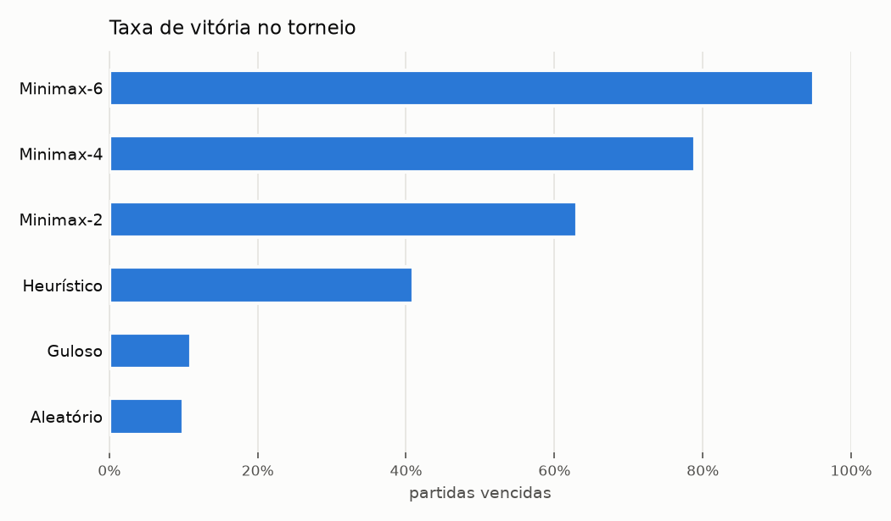

# Othello com Agentes Inteligentes — LLM + Ferramentas + LangGraph

Trabalho Prático 05 de **GCC128 — Inteligência Artificial** (Prof. Ahmed Ali Abdalla Esmin): um agente que
joga Othello (Reversi) **percebendo, raciocinando, usando ferramentas e agindo** — o LLM é um nó de um grafo
LangGraph que precisa chamar ferramentas para observar o tabuleiro e para executar a jogada. O projeto inclui
também agentes clássicos (aleatório, guloso, heurístico e Minimax alfa-beta), interface gráfica, modo
terminal e um módulo de experimentos com torneio (vitória = 3, empate = 1, derrota = 0).

O relatório completo (arquitetura, ferramentas, estratégia, memória, experimentos, limitações e conclusão)
está em [docs/RELATORIO.md](docs/RELATORIO.md).

## Funcionalidades

- **Regras completas do Othello** em *bitboards*: tabuleiro 8×8, jogadas válidas, captura em 8 direções,
  passe automático, fim de jogo e vencedor.
- **Agente LLM em LangGraph** com o ciclo *perceber → raciocinar → usar ferramentas → agir*, cobrança quando
  o LLM não joga, jogada de segurança em caso de falha e **memória** da partida via *checkpointer*.
- **Ferramentas** `get_board_state`, `get_valid_moves`, `make_move`, `get_game_status`, `get_move_history` e,
  no agente planejador, `analyze_moves`, `simulate_move` e `minimax_search`.
- **Explicação de cada jogada** (argumento `reason` de `make_move`), exibida na interface e salva nos
  experimentos.
- **Agentes clássicos:** Aleatório, Guloso, Heurístico (cantos, casas X/C, mobilidade, fronteira, tabela
  posicional, paridade) e Minimax com poda alfa-beta e fim de jogo exato.
- **Interface gráfica (Tkinter)** para Humano × Agente, Agente × Agente e Humano × Humano; **modo terminal**.
- **Experimentos:** torneio todos-contra-todos com aberturas aleatórias, métricas (vitórias, derrotas,
  empates, taxa de vitória, jogadas, tempo por jogada, chamadas ao LLM, tempo de resposta, chamadas de
  ferramentas), relatório em Markdown e gráficos.
- **Provedor de LLM configurável** (`init_chat_model`): Anthropic (padrão), OpenAI, Gemini, Ollama...

## Estrutura

```
othello/
├── game/          regras (board.py) e ambiente com turnos e histórico (environment.py)
├── agents/        interface, agentes clássicos, avaliação heurística, minimax, registro
├── llm/           ferramentas, prompts, configuração do modelo, grafo LangGraph, modelos simulados
├── ui/            interface gráfica (gui.py) e de terminal (cli.py)
├── experiments/   torneio, métricas e relatório
└── __main__.py    linha de comando: gui | play | experiment | report | graph
tests/             testes automatizados (pytest)
results/           resultados dos experimentos (CSV, JSONL, JSON, report.md, gráficos)
docs/RELATORIO.md  relatório do trabalho
```

## Instalação

Requer Python 3.10+.

```bash
python -m venv .venv
# Windows: .venv\Scripts\activate    |    Linux/macOS: source .venv/bin/activate
pip install -r requirements.txt
```

### Configurando o LLM

Copie `.env.example` para `.env` e preencha a chave do provedor:

```env
OTHELLO_LLM_MODEL=anthropic:claude-opus-5-5
ANTHROPIC_API_KEY=sua-chave
# OTHELLO_LLM_EFFORT=low   # opcional: menos raciocínio = jogadas mais rápidas e baratas
```

O modelo usa o formato `provedor:modelo` do LangChain e também pode ser passado com `--model`. Para usar
outro provedor, instale o pacote dele e troque a especificação, por exemplo `openai:gpt-4.1-mini`
(`pip install langchain-openai`) ou `ollama:llama3.1` (`pip install langchain-ollama`, com o Ollama rodando).

#### Usando o Groq

```bash
pip install langchain-groq
```

```env
OTHELLO_LLM_MODEL=groq:openai/gpt-oss-120b
GROQ_API_KEY=sua-chave
# OTHELLO_LLM_EFFORT=low   # opcional: esforço de raciocínio dos modelos gpt-oss
```

Na documentação do Groq (novembro de 2026), `openai/gpt-oss-120b` e `openai/gpt-oss-20b` são os modelos de
produção de uso livre e ambos suportam ferramentas. Eles não fazem chamadas de ferramentas em paralelo, então
cada jogada usa mais chamadas ao modelo (o limite é 10 por turno). Se o Groq rejeitar uma chamada de
ferramenta malformada (`tool_use_failed`), o agente tenta de novo uma vez antes de recorrer à jogada de
segurança. Faça um teste curto antes dos experimentos:
`python -m othello play --black llm-planner --white random`.
Para partidas longas ou muitos experimentos, um modelo menor (por exemplo `anthropic:claude-haiku-5-5`)
reduz bastante o custo e a latência.

Sem chave, use `--model mock`: um modelo **simulado** (não é um LLM) que segue o mesmo protocolo de
ferramentas, útil para ver o fluxo do agente funcionando. Se a chamada ao LLM real falhar, o agente faz uma
jogada de segurança heurística e avisa no log — o jogo nunca trava.

## Como jogar

```bash
# Interface gráfica (escolha os jogadores de cada cor no painel)
python -m othello

# Terminal: Humano (pretas) x LLM planejador (brancas)
python -m othello play --black human --white llm-planner

# Terminal: Agente x Agente
python -m othello play --black minimax:4 --white llm-basic --delay 1
```

Agentes disponíveis: `human`, `random`, `greedy`, `heuristic`, `minimax[:N]`, `llm-basic`, `llm-planner`.
No terminal, digite a casa (ex.: `d3`), `historico` ou `sair`.

## Experimentos

```bash
# Torneio dos agentes clássicos (usado no relatório)
python -m othello experiment --agents random greedy heuristic minimax:2 minimax:4 minimax:6 \
    --games 20 --opening 4 --seed 42 --out results/torneio-classico

# LLM básico x LLM planejador, cada um contra o heurístico (exige chave de API)
python -m othello experiment --agents llm-basic llm-planner --vs heuristic --games 10 --out results/llm-vs-heuristico

# LLM básico x LLM planejador em confronto direto
python -m othello experiment --agents llm-basic llm-planner --games 10 --out results/llm-basico-vs-planejador

# Regenerar report.md e gráficos de uma pasta de resultados
python -m othello report results/torneio-classico
```

Cada execução grava `games.csv` (uma linha por partida), `moves.jsonl` (uma linha por jogada, com
justificativa e ferramentas usadas), `summary.json`, `report.md` e os gráficos `taxa_vitoria.png` e
`tempo_por_jogada.png`. O CSV e o JSONL são gravados a cada partida, então uma execução interrompida não
perde o que já foi jogado.

## Resultados

Torneio de 300 partidas entre os agentes clássicos (15 confrontos × 20 partidas, cores alternadas, aberturas
aleatórias de 4 lances; vitória = 3, empate = 1, derrota = 0):

| # | Agente | Pontos | V – E – D | Taxa de vitória | Saldo médio de peças | Tempo médio/jogada |
|---|---|---|---|---|---|---|
| 1 | Minimax-6 | **286** | 95 – 1 – 4 | 95% | +40,4 | 188 ms |
| 2 | Minimax-4 | **238** | 79 – 1 – 20 | 79% | +30,6 | 19 ms |
| 3 | Minimax-2 | **189** | 63 – 0 – 37 | 63% | +13,6 | 6 ms |
| 4 | Heurístico | **123** | 41 – 0 – 59 | 41% | −10,9 | 0,3 ms |
| 5 | Guloso | **33** | 11 – 0 – 89 | 11% | −37,8 | 0,03 ms |
| 6 | Aleatório | **30** | 10 – 0 – 90 | 10% | −35,9 | 0,01 ms |



Principais conclusões: a força cresce com a profundidade da busca; a avaliação heurística sozinha já vence
os agentes ingênuos, mas perde para quem olha 2 lances à frente; o Guloso não é melhor que o Aleatório; e os
agentes de busca jogam em cantos de 4 a 6 vezes mais e em casas X/C bem menos que os agentes fracos. Detalhes
e análise qualitativa em [docs/RELATORIO.md](docs/RELATORIO.md#8-experimentos) e
[results/torneio-classico/report.md](results/torneio-classico/report.md).

Os experimentos com os agentes LLM (básico × planejador, e cada um contra o Heurístico) estão prontos para
rodar com os comandos acima, mas **ainda não foram executados**: o ambiente de desenvolvimento não tinha chave
de API. Ver a seção 8.3 do relatório.

## Testes

```bash
python -m pytest
```

Os testes cobrem as regras (incluindo comparação dos bitboards com uma implementação ingênua em 60 partidas
aleatórias), os agentes clássicos, as ferramentas e o grafo do agente LLM (com modelos roteirizados:
caminho feliz, jogada inválida, LLM que não joga, erro de API e memória) e o módulo de experimentos. Não
fazem chamadas de rede.

Para ver o grafo do agente em Mermaid: `python -m othello graph`.

## Entrega

- Compactar o projeto como `nome1_nome2.zip` (código, `docs/RELATORIO.md`, este README e o link do vídeo).
- Vídeo (8–10 min) sugerido: arquitetura e grafo do agente → ferramentas → partida Humano × Agente LLM na
  interface (mostrando as justificativas e as ferramentas no log) → partida Agente × Agente com "Próxima
  jogada" → resultados dos experimentos.
- Link do vídeo: _(adicionar aqui)_
