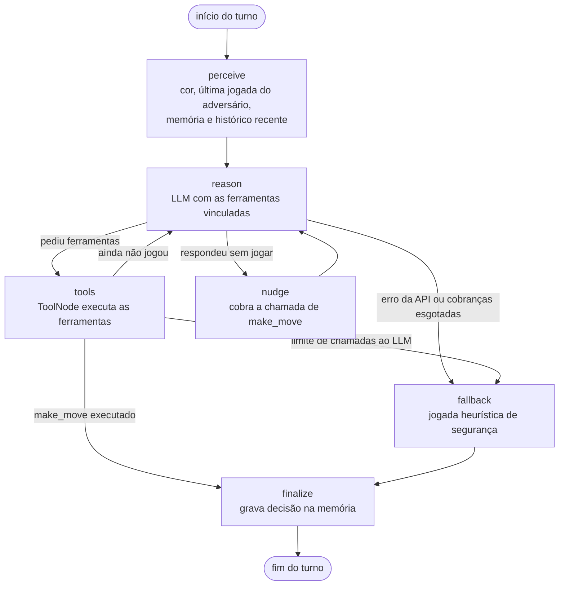
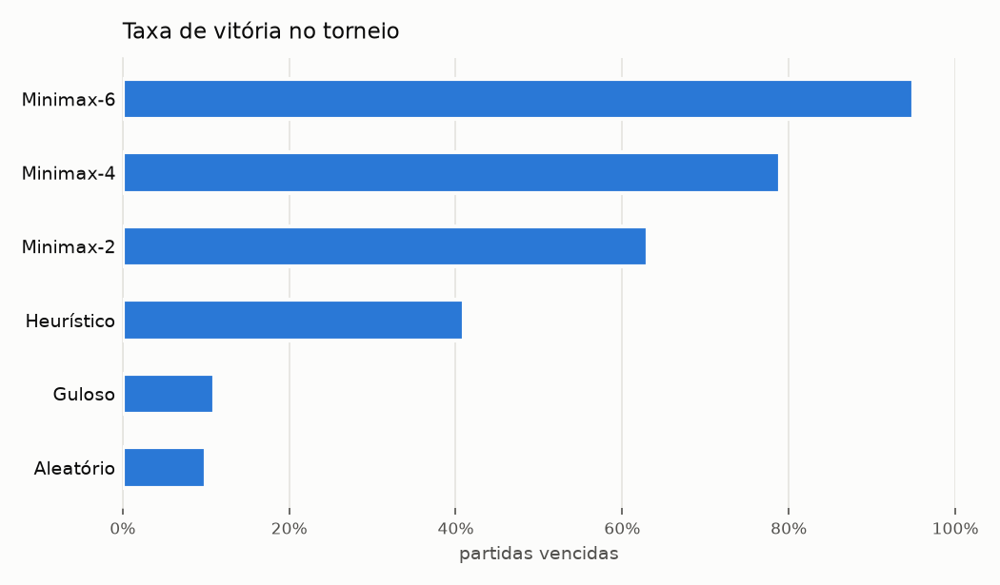
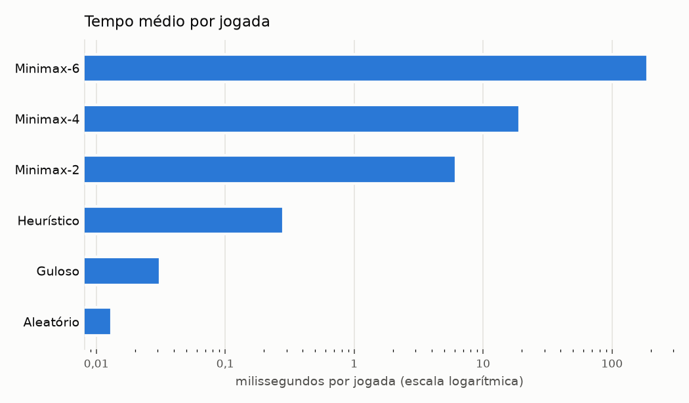

# Relatório — TP05: Agentes Inteligentes para Jogos (Othello)

**Disciplina:** GCC128 — Inteligência Artificial · **Professor:** Ahmed Ali Abdalla Esmin
**Autor:** João Vitor Givisiez Lessa
**Tecnologias:** Python 3.11 · LangChain 1.x · LangGraph 1.x · Tkinter · matplotlib

---

## 1. Objetivo

Projetar e implementar um **agente inteligente** que joga Othello usando um LLM, ferramentas (*tools*) e
interação com o ambiente. O agente observa o estado do jogo, consulta ferramentas, analisa as alternativas,
decide, executa a jogada e repete o ciclo até o fim da partida. Além do agente LLM, foram implementados
agentes clássicos (aleatório, guloso, heurístico e Minimax com poda alfa-beta) que servem de adversários e de
linha de base nos experimentos.

## 2. Arquitetura

```
othello/
├── game/          Regras e ambiente
│   ├── board.py         tabuleiro em bitboards, jogadas válidas, capturas, fim de jogo
│   └── environment.py   OthelloGame: turnos, passes automáticos, status e histórico
├── agents/        Agentes clássicos
│   ├── base.py          interface Agent / TurnResult (jogada + justificativa + métricas)
│   ├── simple.py        Aleatório e Guloso
│   ├── evaluation.py    função de avaliação heurística e análise de jogadas
│   ├── heuristic.py     agente heurístico (1 lance)
│   ├── minimax.py       Minimax com poda alfa-beta
│   └── registry.py      criação de agentes por nome ("minimax:4", "llm-planner", ...)
├── llm/           Agente LLM
│   ├── tools.py         ferramentas LangChain (perceber e agir no jogo)
│   ├── prompts.py       prompt de sistema e prompt de percepção do turno
│   ├── config.py        escolha do modelo via init_chat_model ("provedor:modelo")
│   ├── agent.py         grafo LangGraph do agente
│   └── mock.py          modelos simulados para testes (não são LLMs)
├── ui/            Interfaces: gui.py (Tkinter) e cli.py (terminal)
├── experiments/   Partidas em lote, métricas, torneio e relatório
└── __main__.py    python -m othello {gui, play, experiment, report, graph}
```

**Ambiente.** O `OthelloGame` é o "mundo" do agente. O tabuleiro é representado por dois inteiros de 64 bits
(*bitboards*): as jogadas válidas e as peças capturadas são calculadas com deslocamentos de bits nas 8
direções, o que é dezenas de vezes mais rápido que percorrer uma matriz em Python e permite ao Minimax buscar
mais fundo. O ambiente controla a vez, registra passes automaticamente, detecta o fim de jogo e guarda o
**histórico** completo (jogada, peças viradas, placar, agente e justificativa).

**Interface comum de agentes.** Todo agente implementa `play_turn(game)`: ele observa o ambiente, decide e
**executa** a jogada no próprio ambiente, devolvendo um `TurnResult` (jogada, justificativa, tempo, chamadas
ao LLM, chamadas de ferramentas, tentativas inválidas, uso de jogada de segurança). Assim o laço da partida é
o mesmo para humanos, agentes clássicos e agentes LLM — no caso do LLM, quem executa a jogada é a ferramenta
`make_move`.

### 2.1 O agente LLM como grafo LangGraph

O LLM não recebe o tabuleiro e devolve uma posição: ele é um nó dentro de um fluxo de decisão em que precisa
usar ferramentas para perceber o jogo e para agir.



| Nó | Papel |
|---|---|
| `perceive` | Monta a percepção do turno: cor do agente, última jogada do adversário, as últimas decisões do próprio agente (memória) e o histórico recente da partida. Limpa a conversa do turno anterior (`RemoveMessage(REMOVE_ALL_MESSAGES)`), mantendo apenas a memória de longo prazo. |
| `reason` | Chama o LLM com as ferramentas vinculadas (`bind_tools`). Mede o tempo de resposta e conta as chamadas. |
| `tools` | `ToolNode` do LangGraph: executa as ferramentas pedidas e devolve os resultados ao LLM. |
| `nudge` | Se o LLM responder sem chamar `make_move`, lembra-o das jogadas válidas (até 2 vezes). |
| `fallback` | Jogada de segurança pela melhor avaliação heurística quando a API falha, o LLM não joga após as cobranças ou o limite de 8 chamadas por turno é atingido. O jogo nunca trava. |
| `finalize` | Registra "Turno N: joguei X. <justificativa>" na memória do agente. |

Assim que `make_move` é executado o turno termina, sem uma chamada extra ao LLM só para "fechar" a conversa.

## 3. Ferramentas

As ferramentas são funções LangChain (`@tool`) fechadas sobre um `ToolContext` que aponta para a partida e o
jogador do turno. As docstrings viram as descrições enviadas ao modelo.

| Ferramenta | Modo | O que faz |
|---|---|---|
| `get_board_state()` | básico e planejador | Tabuleiro ASCII com coordenadas, jogadas válidas marcadas com `*`, cor do agente, placar e casas vazias. |
| `get_valid_moves()` | básico e planejador | Jogadas válidas do jogador da vez e as peças que cada uma vira. |
| `make_move(position, reason)` | básico e planejador | **Única ação do agente.** Valida a vez e a jogada, executa no ambiente e registra a justificativa. Jogada inválida devolve erro com a lista de jogadas válidas (o LLM pode se corrigir); uma segunda jogada no mesmo turno é recusada. |
| `get_game_status()` | básico e planejador | Fim de jogo, resultado, vez, placar, número de jogadas, casas vazias e última jogada. |
| `get_move_history(last_n)` | básico e planejador | Histórico recente da partida (memória do jogo). |
| `analyze_moves()` | planejador | Para cada jogada: peças viradas, tipo de casa (canto, borda, casa X/C), se libera canto ao adversário, mobilidade do adversário depois, peças de fronteira e avaliação heurística. |
| `simulate_move(position)` | planejador | Simula a jogada **sem executá-la**: tabuleiro resultante e as 3 melhores respostas do adversário. |
| `minimax_search(depth)` | planejador | Busca Minimax alfa-beta (profundidade 1–6, fim de jogo exato com ≤ 10 casas vazias) e devolve o valor de cada jogada. |

## 4. Estratégia e tomada de decisão

### 4.1 Função de avaliação heurística

Usada pelo agente heurístico, nas folhas do Minimax e na ferramenta `analyze_moves`. Combina seis critérios,
com os pesos da heurística dinâmica de Sannidhanam & Annamalai (*An Analysis of Heuristics in Othello*):

| Critério | Medida (do ponto de vista do jogador) | Peso |
|---|---|---|
| Cantos | 25 × (cantos meus − cantos do adversário) | 801,7 |
| Proximidade de canto | −12,5 × (minhas peças em casas X/C de cantos vazios − as do adversário) | 382,0 |
| Mobilidade | 100 × (minhas jogadas − dele) / (soma) | 78,9 |
| Fronteira | −100 × (minhas peças de fronteira − dele) / (soma) | 74,4 |
| Posicional | soma de uma tabela de pesos por casa (cantos +100, casas X −50, ...) | 10 |
| Paridade de peças | 100 × (minhas peças − dele) / (soma) | 10 (120 nas últimas 14 casas) |

Posições finais recebem valor exato (±1.000.000 + diferença de peças), de modo que vitória e derrota
dominam qualquer heurística.

### 4.2 Agentes clássicos

* **Aleatório** — escolhe uma jogada válida ao acaso (linha de base).
* **Guloso** — maximiza as peças viradas no lance atual.
* **Heurístico** — escolhe a jogada com a melhor avaliação da posição resultante (1 lance, sem prever a resposta).
* **Minimax alfa-beta** — busca negamax com poda alfa-beta até a profundidade N, com ordenação de jogadas
  (tabela posicional e, nos níveis altos, menor mobilidade do adversário) para aumentar as podas, tratamento
  de passe dentro da árvore e **fim de jogo exato**: com até 10 casas vazias a busca vai até o final da
  partida. No torneio da seção 8 a média foi de 19 ms por jogada na profundidade 4 e 188 ms na profundidade 6.

### 4.3 Agentes LLM

* **LLM básico** — recebe apenas as ferramentas do enunciado e o histórico; deve raciocinar sozinho sobre
  as jogadas válidas usando os princípios estratégicos do prompt (cantos, casas X/C, mobilidade, fronteira,
  paridade no final).
* **LLM planejador** — além delas, tem `analyze_moves`, `simulate_move` e `minimax_search`. O prompt pede
  que compare as alternativas com a análise e a busca antes de decidir e permite discordar da busca com
  justificativa. É a combinação **LLM + heurística + planejamento** sugerida no enunciado.

Nos dois casos o LLM **explica cada jogada** no argumento `reason` de `make_move`; a justificativa aparece no
log da interface, no histórico da partida e no `moves.jsonl` dos experimentos. Os agentes clássicos também
geram justificativas; por exemplo, uma jogada real do Minimax-2 numa partida pelo terminal: "Minimax
alfa-beta: melhor valor esperado (159) supondo a melhor resposta do adversário (profundidade 2, 13 nós). e3
(interior) vira 1 peça(s); deixa o adversário com 5 jogada(s).".

## 5. Memória e estado

* **Histórico da partida (ambiente):** cada jogada e passe é registrado no `OthelloGame` com peças viradas,
  placar, agente e justificativa. O agente o consulta por `get_move_history` e o recebe resumido a cada turno.
* **Memória do agente (LangGraph):** o grafo é compilado com um *checkpointer* (`InMemorySaver`) e cada
  partida/cor usa um `thread_id` próprio. O campo `memory` do estado tem um *reducer* de concatenação, então
  as decisões e justificativas se acumulam ao longo da partida e as últimas 6 voltam no prompt do turno
  seguinte (o agente "lembra" do plano que vinha seguindo). Uma nova partida começa com memória vazia.
* **Memória de curto prazo:** as mensagens do turno (chamadas e resultados de ferramentas) ficam no estado
  apenas durante o turno e são descartadas no início do próximo, o que mantém o contexto pequeno e o custo
  estável ao longo da partida.

## 6. Robustez

* Toda jogada passa pela validação do ambiente; o LLM não consegue jogar fora da vez nem em casa inválida.
* Jogada inválida → mensagem de erro com as jogadas válidas e nova chance (contabilizada em
  `invalid_attempts`).
* LLM que responde sem jogar → até 2 cobranças (`nudge`); depois, jogada de segurança.
* Erro de rede/API, recusa ou limite de 8 chamadas por turno → jogada de segurança heurística, marcada como
  tal no log, na memória e nas métricas (`fallbacks`).
* O modelo é criado apenas quando o agente joga, então a interface abre mesmo sem chave de API.

## 7. Interface e modos de jogo

* **Interface gráfica (Tkinter):** `python -m othello` — tabuleiro clicável com coordenadas, jogadas válidas
  destacadas, marcação da última jogada, placar, escolha do jogador de cada cor (Humano, Aleatório, Guloso,
  Heurístico, Minimax 2/4/6, LLM básico, LLM planejador) e do modelo LLM. Cobre **Humano × Agente**,
  **Agente × Agente** e Humano × Humano. Tem controle de atraso, pausa e "Próxima jogada" para acompanhar
  partidas entre agentes lance a lance, e um log com a justificativa de cada jogada e a sequência de
  ferramentas chamadas pelo LLM. Os agentes rodam numa *thread* separada, então a janela não congela
  enquanto o LLM responde.
* **Terminal:** `python -m othello play --black human --white llm-planner`.
* **Experimentos:** `python -m othello experiment ...` (seção 8).

## 8. Experimentos

### 8.1 Protocolo

* **Torneio todos-contra-todos** (`python -m othello experiment`), com a pontuação do desafio da disciplina:
  vitória = 3, empate = 1, derrota = 0.
* **Cores alternadas:** em cada confronto metade das partidas é jogada com cada cor.
* **Aberturas aleatórias:** cada par de partidas (A de pretas, depois B de pretas) começa da mesma sequência
  de 4 lances aleatórios. Sem isso, dois agentes determinísticos repetiriam sempre a mesma partida; com a
  mesma abertura para as duas cores, a comparação continua justa.
* **Métricas:** vitórias, derrotas, empates, taxa de vitória, pontos, saldo médio de peças, número de
  jogadas, tempo médio e máximo por jogada e, para os agentes LLM, chamadas ao LLM por jogada, tempo médio de
  resposta, chamadas de ferramentas por jogada, jogadas inválidas e jogadas de segurança.
* **Dados brutos:** `games.csv` (uma linha por partida) e `moves.jsonl` (uma linha por jogada, com a
  justificativa), além de `summary.json`, `report.md` e gráficos, na pasta de cada experimento.

### 8.2 E1 — Agentes clássicos (executado)

Comando: `python -m othello experiment --agents random greedy heuristic minimax:2 minimax:4 minimax:6
--games 20 --opening 4 --seed 42 --out results/torneio-classico`. Foram 15 confrontos × 20 partidas = **300
partidas** (média de 59,5 jogadas por partida), executadas em cerca de 10 minutos num notebook com Windows 11 e
Python 3.11. Dados completos em [`results/torneio-classico/`](../results/torneio-classico/report.md).

**Classificação**

| # | Agente | J | V | E | D | Pontos | Taxa de vitória | Saldo médio de peças | Tempo médio/jogada | Maior tempo de jogada |
|---|---|---|---|---|---|---|---|---|---|---|
| 1 | Minimax-6 | 100 | 95 | 1 | 4 | **286** | 95,0% | +40,4 | 188,4 ms | 3,65 s |
| 2 | Minimax-4 | 100 | 79 | 1 | 20 | **238** | 79,0% | +30,6 | 19,2 ms | 0,57 s |
| 3 | Minimax-2 | 100 | 63 | 0 | 37 | **189** | 63,0% | +13,6 | 6,2 ms | 0,52 s |
| 4 | Heurístico | 100 | 41 | 0 | 59 | **123** | 41,0% | −10,9 | 0,3 ms | 1 ms |
| 5 | Guloso | 100 | 11 | 0 | 89 | **33** | 11,0% | −37,8 | 0,03 ms | < 1 ms |
| 6 | Aleatório | 100 | 10 | 0 | 90 | **30** | 10,0% | −35,9 | 0,01 ms | < 1 ms |





**Confrontos diretos selecionados** (vitórias de A – empates – vitórias de B, em 20 partidas)

| Confronto | Resultado | Saldo médio de A |
|---|---|---|
| Aleatório × Guloso | 10 – 0 – 10 | −0,4 |
| Guloso × Heurístico | 1 – 0 – 19 | −36,2 |
| Heurístico × Minimax-2 | 2 – 0 – 18 | −31,8 |
| Minimax-2 × Minimax-4 | 2 – 0 – 18 | −31,1 |
| Minimax-2 × Minimax-6 | 3 – 0 – 17 | −28,8 |
| Minimax-4 × Minimax-6 | 1 – 1 – 18 | −24,1 |

Os 9 confrontos não listados terminaram todos 20 – 0 para o agente mais forte; a tabela completa está no
`report.md` do experimento. Não houve vantagem relevante de cor: as pretas venceram 147
partidas, as brancas 152 e houve 1 empate.

**Uso de casas estratégicas** (porcentagem das jogadas de cada agente)

| Agente | Cantos | Casas X | Casas C | Outras bordas | Interior |
|---|---|---|---|---|---|
| Minimax-6 | 12,2% | 4,3% | 11,0% | 31,4% | 41,2% |
| Minimax-4 | 10,6% | 4,7% | 12,3% | 31,1% | 41,4% |
| Minimax-2 | 8,4% | 6,8% | 12,5% | 29,7% | 42,6% |
| Heurístico | 6,5% | 6,7% | 13,1% | 29,6% | 44,1% |
| Guloso | 1,9% | 10,4% | 19,0% | 24,8% | 43,9% |
| Aleatório | 1,9% | 10,1% | 18,1% | 24,2% | 45,7% |

**Análise quantitativa**

* A classificação é **monotônica na capacidade de antecipação**: cada 2 lances a mais de busca subiram a taxa
  de vitória (63% → 79% → 95%) e o saldo médio de peças (+13,6 → +30,6 → +40,4). Nos confrontos diretos, o
  Minimax mais profundo venceu 17 ou 18 de cada 20 partidas.
* O custo cresce mais rápido que a força: de 6,2 ms (profundidade 2) para 19,2 ms (4) e 188,4 ms (6) por
  jogada, com pico de 3,65 s numa posição do Minimax-6. A profundidade 4 é o melhor compromisso para uma
  interface responsiva; a 6 cabe com folga no tempo de um torneio.
* A função de avaliação sozinha já explica boa parte da força: o Heurístico (0,3 ms por jogada) venceu o
  Aleatório 20 – 0 e o Guloso 19 – 1. Mas olhar só 2 lances à frente com a mesma avaliação (Minimax-2) foi
  suficiente para vencê-lo 18 – 2.
* O agente **Guloso não foi melhor que o Aleatório** (10 – 10, saldo −0,4).

**Análise qualitativa**

* **Cantos e casas perigosas.** Os agentes Minimax jogam em cantos com frequência de 4,4 a 6,4 vezes maior que
  os fracos (de 8,4% a 12,2% das jogadas, contra 1,9% do Guloso e do Aleatório) e jogam muito menos nas casas X
  (4,3% contra cerca de 10%) e C (11% contra 18–19%). Ou seja, os agentes de busca reproduziram o princípio
  estratégico clássico do Othello: não entregar cantos e tomá-los quando possível.
* **Por que o guloso perde.** Virar o máximo de peças cedo aumenta as peças de fronteira e dá mobilidade ao
  adversário; o Guloso também é o que mais joga em casas X/C (29,4% das jogadas). Em Othello, mobilidade e
  posição valem mais que material no meio de jogo — exatamente o que a heurística codifica.
* **A partida é decidida no meio de jogo.** Em todas as partidas vencidas pelos agentes Minimax (63, 79 e
  95), a busca exata anunciou "vitória garantida" logo que entrou na janela de fim de jogo (mediana no lance
  52), e isso nunca aconteceu numa partida que não venceram (conferido partida a partida no `moves.jsonl`). A vantagem já estava construída quando restavam 10 casas;
  o que diferencia os agentes é a qualidade das decisões no meio de jogo, que depende da profundidade.
* **Explicações.** Todas as jogadas vêm com justificativa. Exemplos reais do `moves.jsonl`:
  * Minimax-6: "Minimax alfa-beta: melhor valor esperado (56491) supondo a melhor resposta do adversário
    (profundidade 6, 3951 nós). e8 (borda) vira 2 peça(s); deixa o adversário com 0 jogada(s)."
  * Minimax-6 no fim de jogo: "Minimax alfa-beta: vitória garantida por 50 peça(s) com jogo perfeito. b4
    (interior) vira 8 peça(s); deixa o adversário com 1 jogada(s)."
  * Heurístico: "Melhor avaliação heurística (51390): a7 (casa C (vizinha de canto)) vira 1 peça(s); deixa
    o adversário com 4 jogada(s)."
  * Guloso: "c1 vira o maior número de peças (6)."

### 8.3 E2 — Agentes LLM (protocolo pronto; execução pendente)

O agente LLM, as ferramentas, as métricas e o relatório automático estão implementados e testados, mas **as
partidas com LLM real não foram executadas** porque a máquina de desenvolvimento não tinha chave de API
configurada. Os testes automatizados e uma partida completa com o modelo simulado (`--model mock`, que segue o
protocolo de ferramentas mas não é um LLM) confirmaram que o fluxo, a coleta de métricas e o relatório
funcionam. Nenhum número de LLM é apresentado aqui para não misturar resultados simulados com resultados reais.

Perguntas do experimento:

1. Lendo o tabuleiro apenas por ferramentas, o **LLM básico** joga melhor que os agentes Aleatório e Guloso?
2. As ferramentas de análise e planejamento fazem o **LLM planejador** se aproximar do Minimax, ou o LLM
   piora as escolhas da busca quando discorda dela?
3. Qual o **custo** de cada um: chamadas ao LLM e de ferramentas por jogada, tempo de resposta, jogadas
   inválidas e jogadas de segurança?

Comandos (com `ANTHROPIC_API_KEY` no `.env`; o modelo pode ser trocado com `--model`):

```bash
# LLM básico e LLM planejador, cada um contra o Heurístico e contra o Guloso
python -m othello experiment --agents llm-basic llm-planner --vs heuristic --games 10 --out results/llm-vs-heuristico
python -m othello experiment --agents llm-basic llm-planner --vs greedy --games 10 --out results/llm-vs-guloso
# Confronto direto: LLM básico x LLM planejador
python -m othello experiment --agents llm-basic llm-planner --games 10 --out results/llm-basico-vs-planejador
```

Cada execução gera as mesmas tabelas da seção 8.2 e, adicionalmente, a tabela "Custo dos agentes LLM". As
justificativas de cada jogada ficam no `moves.jsonl` para a análise qualitativa (por exemplo, verificar se as
explicações do LLM são coerentes com a jogada feita e quando o planejador contraria o `minimax_search`).

| Agente | Taxa de vitória vs Heurístico | Chamadas ao LLM/jogada | Tempo médio por chamada | Ferramentas/jogada | Jogadas inválidas | Jogadas de segurança |
|---|---|---|---|---|---|---|
| LLM básico | _a preencher_ | | | | | |
| LLM planejador | _a preencher_ | | | | | |

## 9. Limitações

* **Experimentos com LLM real pendentes.** O código, o protocolo e as métricas dos agentes LLM estão
  prontos e testados com modelos simulados, mas a máquina usada no desenvolvimento não tinha chave de API,
  então as partidas com LLM real ainda precisam ser executadas (seção 8.3).
* **Custo e latência do LLM.** Cada jogada do agente LLM faz várias chamadas ao modelo (observar, analisar,
  agir), o que é ordens de grandeza mais lento e caro que o Minimax; por isso os experimentos com LLM usam
  menos partidas.
* **Dependência das ferramentas.** A força do LLM planejador vem em boa parte de `minimax_search` e
  `analyze_moves`; sem elas o LLM básico depende de "ler" o tabuleiro em texto, tarefa em que modelos de
  linguagem costumam errar (casas, diagonais, capturas).
* **Heurística fixa.** Os pesos da avaliação vieram da literatura e não foram ajustados por aprendizado
  (por exemplo, por *self-play*), e o Minimax não usa tabela de transposição nem livro de aberturas.
* **Python puro.** Mesmo com bitboards, a profundidade 7 já leva mais de 1 s por jogada; motores em C
  buscam muito mais fundo no mesmo tempo.
* **Memória por partida.** A memória do agente vive em memória RAM (`InMemorySaver`) e não é compartilhada
  entre partidas; o agente não aprende com partidas anteriores.

## 10. Conclusão

O trabalho entrega um agente que **percebe, raciocina, usa ferramentas e age**: o LLM está dentro de um grafo
LangGraph em que só consegue ver o tabuleiro e jogar por meio de ferramentas, tem memória da partida, explica
cada jogada e conta com mecanismos de correção (erro de jogada inválida, cobrança e jogada de segurança) que
impedem que uma falha do modelo trave o jogo. O ambiente implementa todas as regras do Othello e foi validado
contra uma implementação de referência; a interface gráfica permite partidas Humano × Agente e
Agente × Agente acompanhando as justificativas e as ferramentas usadas.

O torneio de 300 partidas entre os agentes clássicos mostrou que a **capacidade de antecipação é o fator
decisivo** (Minimax-6 com 95% de vitórias, contra 63% do Minimax-2 e 41% do Heurístico) e que os critérios
estratégicos importam mais que o ganho imediato de peças (o Guloso empatou com o Aleatório). Os agentes de
busca reproduziram, sem regras explícitas sobre isso, o comportamento esperado de bons jogadores: tomar
cantos e evitar as casas X e C.

Essas conclusões orientam o agente LLM planejador, que combina o raciocínio do LLM com ferramentas de IA
clássica (avaliação heurística, simulação e busca alfa-beta): o LLM interpreta as análises, escolhe entre as
candidatas e explica a decisão. O próximo passo é executar o experimento E2 (seção 8.3) para medir quanto as
ferramentas de planejamento melhoram o agente e quanto isso custa em chamadas e tempo. Para o torneio entre
grupos, o Minimax-6 é o agente mais forte entre os testados; o LLM planejador é a opção quando o agente
precisa ser baseado em LLM.
