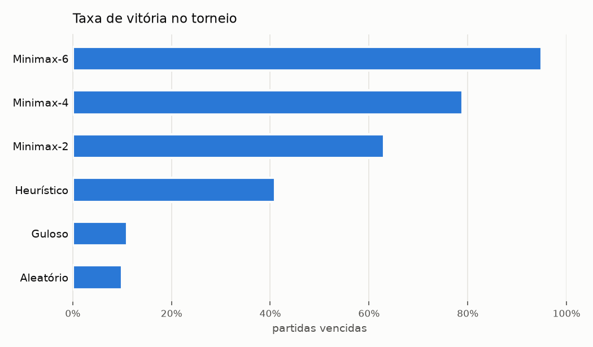
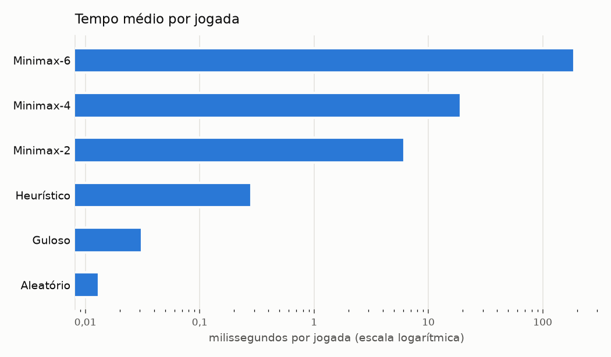

# Resultados do experimento

- Agentes: `random`, `greedy`, `heuristic`, `minimax:2`, `minimax:4`, `minimax:6`
- Partidas por confronto: 20 (cores alternadas; cada par de partidas parte da mesma abertura aleatória de 4 lances)
- Semente: 42
- Execução: 2026-11-04 00:11:33 a 2026-11-04 00:21:56
- Total: 300 partidas, média de 59.5 jogadas por partida; vitórias das pretas: 147, das brancas: 152, empates: 1

## Classificação (vitória = 3, empate = 1, derrota = 0)

| # | Agente | J | V | E | D | Pontos | Taxa de vitória | Saldo médio de peças | Tempo médio/jogada |
|---|---|---|---|---|---|---|---|---|---|
| 1 | Minimax-6 (`minimax:6`) | 100 | 95 | 1 | 4 | **286** | 95.0% | +40.4 | 188.4 ms |
| 2 | Minimax-4 (`minimax:4`) | 100 | 79 | 1 | 20 | **238** | 79.0% | +30.6 | 19.2 ms |
| 3 | Minimax-2 (`minimax:2`) | 100 | 63 | 0 | 37 | **189** | 63.0% | +13.6 | 6.2 ms |
| 4 | Heurístico (`heuristic`) | 100 | 41 | 0 | 59 | **123** | 41.0% | -10.9 | 0.3 ms |
| 5 | Guloso (`greedy`) | 100 | 11 | 0 | 89 | **33** | 11.0% | -37.8 | 0.0 ms |
| 6 | Aleatório (`random`) | 100 | 10 | 0 | 90 | **30** | 10.0% | -35.9 | 0.0 ms |

## Confrontos diretos

| Confronto (A x B) | Partidas | Vitórias A | Empates | Vitórias B | Saldo médio de A |
|---|---|---|---|---|---|
| `random` x `greedy` | 20 | 10 | 0 | 10 | -0.4 |
| `random` x `heuristic` | 20 | 0 | 0 | 20 | -33.4 |
| `random` x `minimax:2` | 20 | 0 | 0 | 20 | -46.1 |
| `random` x `minimax:4` | 20 | 0 | 0 | 20 | -48.6 |
| `random` x `minimax:6` | 20 | 0 | 0 | 20 | -51.1 |
| `greedy` x `heuristic` | 20 | 1 | 0 | 19 | -36.2 |
| `greedy` x `minimax:2` | 20 | 0 | 0 | 20 | -50.1 |
| `greedy` x `minimax:4` | 20 | 0 | 0 | 20 | -52.5 |
| `greedy` x `minimax:6` | 20 | 0 | 0 | 20 | -50.5 |
| `heuristic` x `minimax:2` | 20 | 2 | 0 | 18 | -31.8 |
| `heuristic` x `minimax:4` | 20 | 0 | 0 | 20 | -45.0 |
| `heuristic` x `minimax:6` | 20 | 0 | 0 | 20 | -47.4 |
| `minimax:2` x `minimax:4` | 20 | 2 | 0 | 18 | -31.1 |
| `minimax:2` x `minimax:6` | 20 | 3 | 0 | 17 | -28.8 |
| `minimax:4` x `minimax:6` | 20 | 1 | 1 | 18 | -24.1 |

## Uso de casas estratégicas

Porcentagem das jogadas de cada agente por tipo de casa (cantos = a1, h1, a8, h8; casas X = diagonais vizinhas dos cantos; casas C = vizinhas ortogonais dos cantos).

| Agente | Jogadas | Cantos | Casas X | Casas C | Outras bordas | Interior |
|---|---|---|---|---|---|---|
| Minimax-6 | 2904 | 12.2% | 4.3% | 11.0% | 31.4% | 41.2% |
| Minimax-4 | 2895 | 10.6% | 4.7% | 12.3% | 31.1% | 41.4% |
| Minimax-2 | 2846 | 8.4% | 6.8% | 12.5% | 29.7% | 42.6% |
| Heurístico | 2764 | 6.5% | 6.7% | 13.1% | 29.6% | 44.1% |
| Guloso | 2575 | 1.9% | 10.4% | 19.0% | 24.8% | 43.9% |
| Aleatório | 2670 | 1.9% | 10.1% | 18.1% | 24.2% | 45.7% |

## Gráficos

